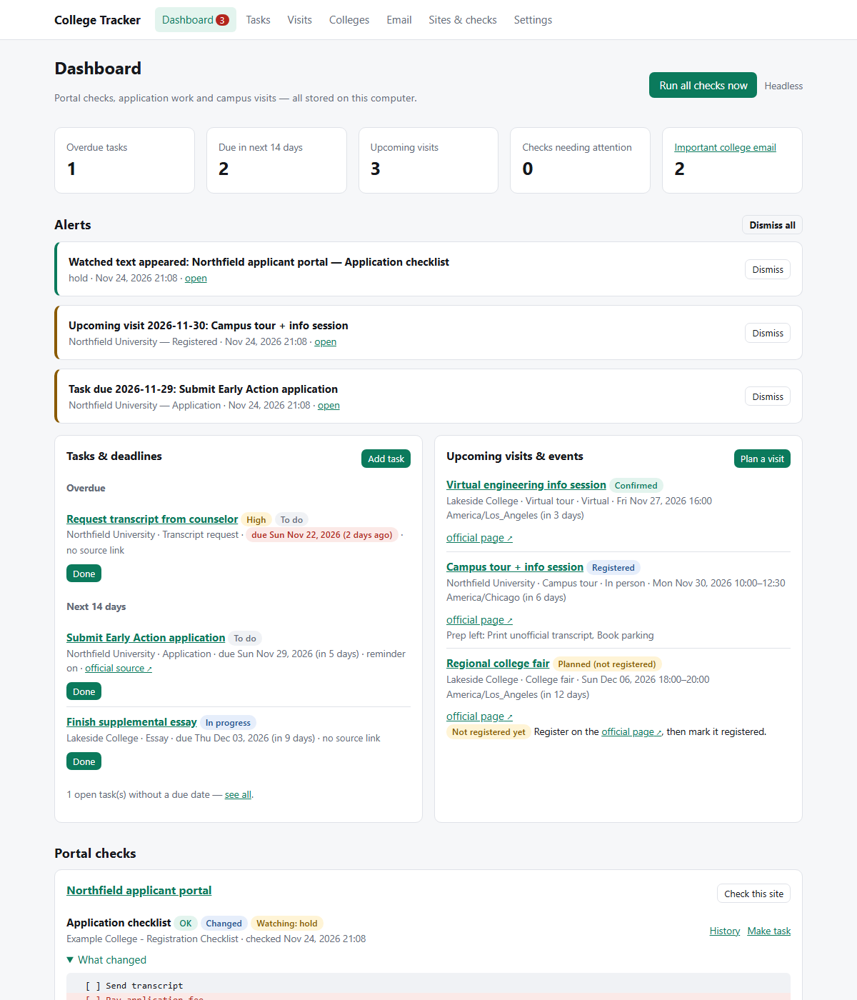
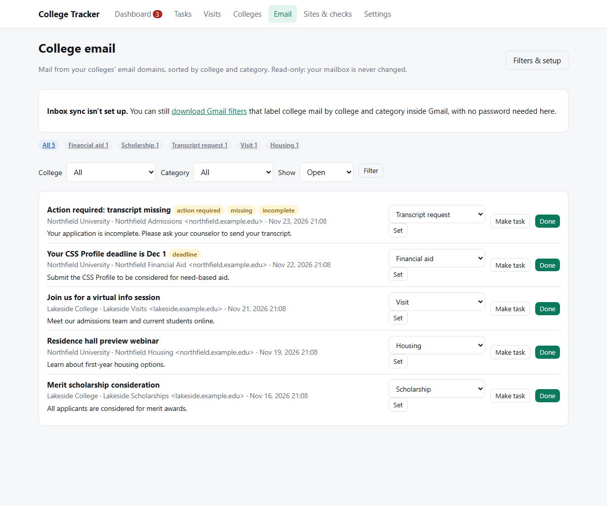

# College Tracker

A local-first college planning hub. It runs on your own computer at
`http://127.0.0.1:5000` and brings together:

- **Portal checks.** Read-only Playwright checks of the college portals you
  are authorised to use, with several pages per site, saved history, diffs,
  watched keywords and alerts.
- **Human-in-the-loop sign-in.** You sign in yourself in a visible browser,
  including MFA, passkeys and CAPTCHAs. The session is saved locally for
  that site. When it expires, the app tells you instead of trying to get
  around it.
- **Application tasks and deadlines.** Each task is linked to a college and
  its official source page. Overdue and upcoming work shows on the
  dashboard.
- **College profiles and campus visits.** Tours, open houses, info sessions,
  class visits, virtual events and college fairs, each with its official
  registration link, RSVP status, logistics, prep checklist, questions,
  notes and follow-ups.
- **College email, sorted by category.** Download Gmail filters that
  label mail as `College/<college>` and `College/<category>`. You can also
  turn on a read-only inbox sync that collects college mail on an Email
  page, flags anything urgent, and turns a message into a task in one
  click.
- **Automation.** Checks, email sync and reminders can run on a timer while
  the app is open, or from Task Scheduler/cron with `python run.py auto`.
- **Opt-in reminders and notifications** (webhook: ntfy, Discord, Slack or
  JSON), plus a `.ics` calendar export.

All data stays on your machine. Read [SECURITY.md](SECURITY.md) for the
trust boundary. Project site: <https://pymite6941.github.io/college-tracker/>





## Quick start

**Windows (cmd or PowerShell)**

```powershell
.\setup.bat
.\run.bat
# open http://127.0.0.1:5000
```

**macOS / Linux**

```bash
chmod +x setup.sh run.sh
./setup.sh
./run.sh
# open http://127.0.0.1:5000
```

The setup scripts use [uv](https://github.com/astral-sh/uv). They create
`.venv`, install dependencies and Playwright Chromium, and copy
`.env.example` to `.env`.

### Commands

| Command | What it does |
|---|---|
| `python run.py` | Start the website (local only) |
| `python run.py check` | Run every check once from the terminal (exit code 1 if any check is not OK) |
| `python run.py remind` | Record due reminders and send notifications, for Task Scheduler or cron |
| `python run.py email` | Sync college email once (read-only) |
| `python run.py secure` | Move saved passwords into the OS keyring (or back), matching `CREDENTIAL_STORE` |
| `python run.py auto` | Run whatever Settings → Automation says is due, then exit (for Task Scheduler or cron) |
| `python scripts/screenshots.py` | Regenerate `docs/screenshots/` from fictional demo data |
| `python -m pytest` | Run the tests (install `requirements-dev.txt` first) |

## Using it

1. **Colleges.** Add each college with its *official* admissions and visit
   pages, copied from the college's own website, plus the **email domains**
   it writes from (for example `northfield.edu`).
2. **Sites & checks.** Add a portal, choose how it signs in, and add one
   check per page you want to watch: checklist, financial aid, housing and
   so on. Optionally add text to watch for, such as `hold`, `missing` or
   `deadline`.
3. **Sign in.** For `manual` sites, click **Sign in**. A Chromium window
   opens. Sign in there, then click **I've signed in — save session** on the
   dashboard banner.
4. **Run checks.** Use **Run all checks now** or **Check this site**. Checks
   run in the background. Each result shows its status, page title, when it
   was checked, any error, and a diff when the page changed.
5. **Tasks and visits.** Turn findings into tasks (**Make task** on any
   check). Plan visits, track registration status (planned → registered →
   confirmed → completed, or cancelled), and tick off prep and follow-ups.

6. **Email.** Use Email → **Filters & setup** to download Gmail filters, or
   connect an inbox for the Email page (see below).
7. **Automation.** Under Settings → **Automation**, choose how often checks
   and email sync run.

### College email

Mail is matched to a college by its sender domain. Subdomains count, so
`finaid.northfield.edu` matches `northfield.edu`, but lookalikes such as
`northfield.edu.evil.com` do not. It is then sorted into the task categories
(application, financial aid, scholarship, transcript, test scores,
recommendation, essay, visit, housing, registration) by keyword rules you
can edit on the setup page.

| Option | Needs | What it does |
|---|---|---|
| **Gmail filters** | Nothing | Download an `.xml` file and import it in Gmail (*Settings → Filters and Blocked Addresses → Import filters*). Gmail adds `College/<college>` and `College/<category>` labels and never sends college mail to spam. The filters never delete, archive or forward. The same rules are also shown as search queries for other mail apps. |
| **Inbox sync** | An IMAP app password | Reads the last *N* days of one folder with the folder opened read-only (`BODY.PEEK`), so nothing is marked read, moved or deleted. Only mail from your colleges' domains is kept, as the subject plus a short snippet, in `data/emails.json`. Important mail ("action required", "missing", "decision", "deadline"…) raises an alert. |

For Gmail, turn on 2-Step Verification, then create an app password under
Google Account → Security → App passwords. The account is saved in the
`[imap]` table of `credentials.toml`. You can also use the `IMAP_HOST`,
`IMAP_USER`, `IMAP_PASSWORD` and `IMAP_FOLDER` variables in `.env`.

### Sign-in modes

| Mode | Use it when | Behaviour |
|---|---|---|
| `manual` (recommended) | SSO, MFA, passkeys, CAPTCHAs | You sign in. The session is saved to `data/auth/<site>.json` and reused. If it expires, checks report **Sign-in needed**. |
| `credentials` | Simple username/password forms | The checker fills in the username and password saved on the Sites page (or `.env`). If MFA or a CAPTCHA appears, it stops with **Sign-in needed**. |
| `none` | Public pages, such as open-house schedules | No sign-in. |

Any site can also run inside a Chrome profile (Sites page → *Chrome
profile*) to reuse Chrome's saved passwords and sign-ins. Chrome must be
closed while checks run.

### Check statuses

| Status | Meaning |
|---|---|
| OK | The page loaded. Compared with the previous OK run, it shows **Changed** or no change. |
| Sign-in needed | The session expired, or the site asked for MFA, a passkey or a CAPTCHA. Use **Sign in**. |
| Login failed | The saved username or password was rejected, or the login form could not be found. |
| Network error | Timeout, DNS failure or connection error. |
| Configuration error | Bad URL, a blocked local address, or a missing check. |

Errors are recorded in history but never count as content changes. Each OK
run is compared with the last *OK* run.

### History, alerts and notifications

- History is kept per check in `data/history/`. Retention is set by
  `HISTORY_MAX_RUNS` (default 50) and `HISTORY_MAX_DAYS` (default 90).
- Alerts appear on the dashboard for changed pages, watched text appearing
  or disappearing, sign-in needed, check errors and due reminders.
- To get alerts on your phone or chat, set `NOTIFY_WEBHOOK_URL` and
  `NOTIFY_FORMAT` in `.env`. Settings → **Send test notification** checks
  the setup.
- Reminders are off unless you tick **Remind me** on a task or visit.
- Settings → **Automation** runs checks every *N* hours, email sync every
  *N* hours, and due reminders. It works while `python run.py` is running.
  For unattended runs, schedule `python run.py auto`.

## Configuration files

| File | Committed? | Purpose |
|---|---|---|
| `sites.json` | yes | Sites and their checks. No secrets. Editable from the UI. |
| `.env` | **no** | Settings (see `.env.example`) |
| `credentials.toml` | **no** | Saved usernames, and passwords unless `CREDENTIAL_STORE=keyring` |
| `data/` | **no** | Results, history, alerts, planner records, saved sessions, stored college email, automation settings |

### `sites.json` format

```json
[
  {
    "id": "state-u",
    "name": "State University portal",
    "auth": "manual",
    "login_url": "https://portal.state.example.edu/login",
    "college_id": "state-university",
    "checks": [
      {
        "id": "checklist",
        "name": "Registration checklist",
        "url": "https://portal.state.example.edu/student/checklist",
        "selectors": ["main", ".checklist"],
        "watch": ["hold", "missing"],
        "wait_for": "#checklist-loaded"
      }
    ]
  }
]
```

Optional per-site keys:

- `selectors.username`, `selectors.password`, `selectors.submit`: login form
  selectors for `credentials` mode.
- `user_env` and `pass_env`: names of `.env` fallback variables.
- `chrome_profile`: run this site inside a Chrome profile.
- `session_max_age_days`: overrides `SESSION_MAX_AGE_DAYS` for this site.
- `login_markers`: text that means "this is a sign-in page".

Older files with `checklist_url` and `checklist_selectors` are upgraded
automatically.

### Supported checks and limitations

- Checks read text from pages your browser session can open. They don't
  click through multi-step flows, download files or submit forms other than
  a login form.
- JavaScript-heavy pages work. Use `wait_for` if content loads late.
- Sites that block automated browsers, or need a hardware key for every
  visit, may need a fresh manual sign-in for each run. That is expected,
  and the app will not work around it.
- Respect each site's terms of use and rate limits. Run checks when you
  need them, not in a tight loop.

## Chrome password import

Sites → **Import logins from Chrome** accepts the CSV from Chrome's
password manager (*Settings → Download file*). Each http(s) login becomes a
site. You can also save its username and password to `credentials.toml`.
Delete the CSV afterwards, because it holds every password in plain text.
The app never reads Chrome's encrypted password database directly.

## Project layout

```
app.py          Flask routes, CSRF/Host/CSP guards
scraper.py      sites.json model, Playwright checks, sign-in, sessions, Chrome import
history.py      history, diffs, watched text, retention, alerts, webhooks
planner.py      colleges, visits/events, tasks, reminders, .ics export
inbox.py        college email: categories, Gmail filter export, read-only IMAP sync
scheduler.py    optional timers for checks, email sync and reminders
security.py     URL validation, request guard, redaction, CSRF helpers
storage.py      atomic JSON storage under data/
jobs.py         one-at-a-time background jobs (checks, sign-in, email)
run.py          entrypoint: serve | check | remind | email | auto
templates/      Jinja templates      static/  CSS + JS (no inline code)
tests/          pytest suite + mock portal for Playwright end-to-end tests
scripts/        screenshots.py (demo data → docs/screenshots)
docs/           GitHub Pages site
```

## Tests

```bash
uv pip install -r requirements-dev.txt --python .venv
.venv/Scripts/python -m pytest          # Windows
.venv/bin/python -m pytest              # macOS / Linux
.venv/Scripts/python -m pytest -m "not e2e"   # skip the Playwright browser tests
```

The end-to-end tests start a local mock portal (`tests/mock_portal.py`) and
use real Chromium to cover: credentials login across several checks, change
and watched-text detection, saved-session reuse, wrong passwords, manual
mode without a session, expired sessions, an MFA challenge, the interactive
sign-in flow, and the block on local-network targets. Email tests use a fake
IMAP server that fails the test if anything other than a read-only fetch is
attempted.

## Campus visit references

- [College Board: visiting a college](https://bigfuture.collegeboard.org/plan-for-college/college-search/visit-a-college)
- [NACAC: college fairs](https://www.nacacnet.org/college-fairs/)
- For a specific event, always save the college's own admissions or
  campus-visit page as its source.
